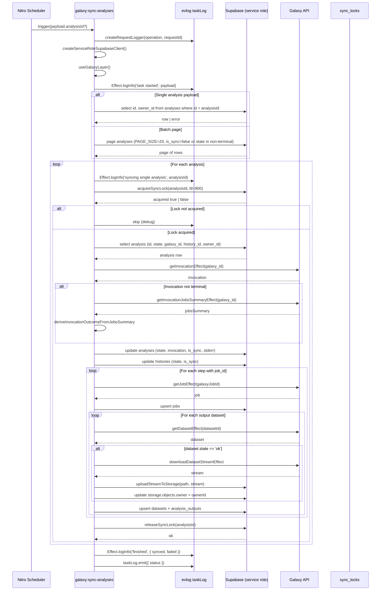

# Galaxy Analysis Sync Contract

**Phase:** 06-audit-and-freeze-the-sync-contract  
**Status:** Frozen pending Phase 8 implementation  
**Owner:** Server-driven scheduled task only  

This document is the canonical reference for how Galaxy analysis state is synchronized into the GaaS Supabase store. It captures the current implementation as of Phase 6 and is intentionally frozen here; any behavioral change must be reviewed against this contract before Phase 8 refactors it.

## Canonical server-driven sync contract

### Operation: `galaxy:sync-analyses`

The sync is performed by a single Nitro scheduled task registered in `packages/nuxt-galaxy/src/module.ts`.

| Attribute | Value |
|-----------|-------|
| Task name | `galaxy:sync-analyses` |
| Cron schedule | `*/30 * * * * *` (every 30 seconds) |
| Handler | `src/runtime/server/tasks/galaxy/sync-analyses.ts` |
| Payload | `{ analysisId?: number }` |
| Task result | `{ synced: number, failed: number, skipped: number, error?: string }` |
| Logger | One `createRequestLogger({ operation: 'galaxy:sync-analyses', requestId: <uuid> })` per run |

When `payload.analysisId` is provided, the task synchronizes exactly that analysis after looking it up by `id` in `galaxy.analyses`. When omitted, the task pages through every analysis that is not yet synced or is in a non-terminal state.

### Call chain and injected dependencies

```text
galaxy:sync-analyses (scheduled task)
  └─ runTaskEffect(taskLog, ...)
       ├─ createServiceRoleSupabaseClient()  → service-role Supabase client
       ├─ useGalaxyLayer()                   → bt.GalaxyFetch Effect Layer
       └─ syncAnalysisEffect(analysisId, ownerId, supabase, galaxyLayer)
            ├─ acquireSyncLock / releaseSyncLock
            ├─ bt.getInvocationEffect
            ├─ bt.getInvocationJobsSummaryEffect   (when invocation not terminal)
            ├─ syncJobEffect(galaxyJobId, stepId, ...)
            │    └─ bt.getJobEffect
            │    └─ syncOutputDatasetEffect(...)   (per step output)
            │         ├─ bt.getDatasetEffect
            │         ├─ bt.downloadDatasetStreamEffect
            │         └─ uploadStreamToStorage
            └─ updateAnalysisMonitoringOutcome
```

The Galaxy layer and Supabase client are created once at the task boundary and passed down. All Effect programs are executed through `runTaskEffect`, which installs the custom `evlogEffectLogger` via AsyncLocalStorage.

### Effect inputs and outputs

#### `syncAnalysisEffect(analysisId, ownerId, supabase, galaxyLayer)`

| Aspect | Details |
|--------|---------|
| File | `src/runtime/server/utils/grizzle/sync/analysis.ts` |
| Inputs | `analysisId`, `ownerId`, service-role `supabase`, `galaxyLayer` |
| Reads | `galaxy.analyses` (id, state, galaxy_id, history_id, owner_id), `galaxy.histories`, `analysis_monitoring` |
| Mutates | `galaxy.analyses` (state, invocation, is_sync, stderr), `galaxy.histories` (state, is_sync), `galaxy.analysis_monitoring` (outcome, completed_at, error_message) |
| Child calls | `acquireSyncLock`, `releaseSyncLock`, `syncJobEffect`, `syncOutputDatasetEffect`, `updateAnalysisMonitoringOutcome`, `getAnalysisStderr` |

#### `syncJobEffect(galaxyJobId, stepId, analysisId, ownerId, supabase, galaxyLayer)`

| Aspect | Details |
|--------|---------|
| File | `src/runtime/server/utils/grizzle/sync/job.ts` |
| Inputs | `galaxyJobId`, `stepId`, `analysisId`, `ownerId`, service-role `supabase`, `galaxyLayer` |
| Reads | `galaxy.jobs` by `galaxy_id` + `analysis_id` |
| Mutates | `galaxy.jobs` (insert or update with state, exit_code, stderr, stdout, is_sync) |
| Returns | The database `id` of the upserted job |

#### `syncOutputDatasetEffect(galaxyDatasetId, analysisId, historyId, jobId, ownerId, supabase, galaxyLayer)`

| Aspect | Details |
|--------|---------|
| File | `src/runtime/server/utils/grizzle/sync/output.ts` |
| Inputs | `galaxyDatasetId`, `analysisId`, `historyId`, `jobId`, `ownerId`, service-role `supabase`, `galaxyLayer` |
| Reads | `galaxy.analysis_outputs`, `galaxy.datasets`, `galaxy.histories` |
| Mutates | `galaxy.datasets` (insert/update), `galaxy.analysis_outputs` (insert/update), `storage.objects` (owner update after service-role upload) |
| Side effects | Downloads dataset stream from Galaxy; uploads stream to Supabase Storage bucket `analysis_files` |

### Lock semantics

Implemented in `src/runtime/server/utils/grizzle/sync/lock.ts`.

| Attribute | Value |
|-----------|-------|
| Table | `galaxy.sync_locks` |
| TTL | Hard-coded `ttlSeconds = 900` (15 minutes) |
| Unique constraint | `analysis_id` is `UNIQUE` |
| Algorithm | Read existing lock → if expired, delete → insert new lock → return `true`; if unexpired, return `false` |
| Race window | The select-then-delete-then-insert is not atomic; two concurrent workers can both see no/expired lock and collide on insert. The insert unique-violation (`23505`) is caught and returns `false`. |
| Release | `releaseSyncLock` deletes the row by `analysis_id`. |
| Scope | A lock is acquired and released inside `Effect.scoped` via `Effect.addFinalizer`. |

### Paging rules

For the batch (no `analysisId`) path in `sync-analyses.ts`:

- `PAGE_SIZE = 20`
- Order by `id ASC`
- Filter: `.or('is_sync.eq.false,state.in.(new,requires_materialization,ready,scheduled,cancelling)')`
- Pages until `page.data.length < PAGE_SIZE`

### Terminal-state rules

Defined in `src/runtime/server/utils/grizzle/analysisMonitoring.ts` and applied in `syncAnalysisEffect`.

- `isInvocationTerminalState(state)` returns `true` for terminal Galaxy invocation states.
- If the fetched invocation is not terminal, `bt.getInvocationJobsSummaryEffect` is called and `deriveInvocationOutcomeFromJobsSummary(jobsSummary)` derives an outcome.
- Derived outcome mapping: `success` → `completed`, `error` → `failed`, otherwise `cancelled`.
- When terminal, the analysis row is updated with:
  - `state = effectiveState`
  - `invocation = invocation` (full Galaxy response object)
  - `is_sync = true`
  - `stderr` from the first non-empty job stderr if state is `failed`
- The linked `histories` row is updated to `state = 'ok'` if terminal, else `'running'`, and `is_sync = isTerminal`.
- Terminal outcomes are mirrored to `analysis_monitoring` via `updateAnalysisMonitoringOutcome`.

### Error handling

- Per-analysis errors inside `syncAnalysisEffect` are caught by the caller in `sync-analyses.ts` using `Effect.tapError` + `Effect.match`, producing either `synced` or `failed` for that analysis without crashing the batch.
- The top-level scheduled task Effect uses `Effect.catchAll` to log the error and return `{ synced: 0, failed: 1, skipped: 0, error: String(error) }`.
- The final `taskLog.emit({ status: result.failed > 0 ? 500 : 200 })` is always executed.

### evlog integration

- `runTaskEffect` installs the `evlogEffectLogger` as the Effect default logger and sets `Logger.minimumLogLevel(LogLevel.Debug)`.
- `Effect.logInfo`, `Effect.logDebug`, and `Effect.logError` are routed to the per-task request logger.
- `Effect.logDebug` is forwarded to evlog's global `log.debug(...)` because the request logger does not expose a `debug` method.
- `syncAnalysisEffect` annotates all child logs with `Effect.annotateLogs({ analysisId: String(analysisId) })`.

### Sequence diagram



## Legacy sync inventory

The following helpers are part of the older Drizzle-based sync path kept in `packages/nuxt-galaxy/src/runtime/server/utils/grizzle/`. They are not invoked by the canonical `galaxy:sync-analyses` scheduled task. Each definition and remaining internal call site is tagged with `// LEGACY-SYNC: remove in Phase 8`.

| # | Helper | File:Line | Callers | Status | Tables / data mutated |
|---|--------|-----------|---------|--------|-----------------------|
| 1 | `synchronizeAnalysisEffect` | `analyses.ts:220` | `synchronizeAnalysesEffect` (legacy), tests | dead | `analyses`, `histories`, `analysis_monitoring` (via `updateAnalysisTerminalState`) |
| 2 | `synchronizeAnalysesEffect` | `analyses.ts:368` | none outside tests/mocks | dead | `analyses`, `histories`, `jobs`, `datasets`, `analysis_inputs`, `analysis_outputs`, `analysis_monitoring` (via children) |
| 3 | `synchronizeHistoryEffect` | `histories.ts:25` | `synchronizeAnalysisEffect` (legacy) | dead | `histories`, `analysis_inputs`, `datasets` (via children) |
| 4 | `synchronizeJobsEffect` | `analyses.ts:197` | `synchronizeHistoryEffect` (legacy) | dead | `jobs`, `datasets`, `analysis_outputs` (via children) |
| 5 | `synchronizeJobEffect` | `jobs.ts:105` | `synchronizeJobsEffect` (legacy) | dead | `jobs` |
| 6 | `synchronizeInputDatasetEffect` | `datasets/input.ts:126` | `synchronizeHistoryEffect` (legacy) | dead | `analysis_inputs`, `datasets`, `storage.objects` (via upload) |
| 7 | `synchronizeOutputDatasetEffect` | `datasets/output.ts:18` | `synchronizeOutputDatasetsEffect` (legacy) | dead | `analysis_outputs`, `datasets`, `storage.objects` (via upload) |
| 8 | `synchronizeOutputDatasetsEffect` | `jobs.ts:152` | `synchronizeJobEffect` (legacy) | dead | `analysis_outputs`, `datasets`, `storage.objects` (via child) |

### Client surface check

A search of `packages/ui`, `packages/wiki`, and `playground` (excluding `node_modules` and generated directories) found **no direct calls** to `syncAnalysisEffect`, `synchronizeAnalysisEffect`, `synchronizeAnalysesEffect`, or the `galaxy:sync-analyses` task. The analysis detail page at `packages/ui/app/pages/analyses/[analysisId].vue` uses `useSupabaseRealtime` only to refresh displayed query results when underlying tables change; it does not trigger sync mutations.

## evlog trace audit gaps

The canonical path already emits structured logs, but the following gaps were identified during the Phase 6 audit. They are deferred to Phase 7 (standardize evlog traces) unless marked as a small observability-only fix that carries no behavior change.

### Gap 1: No structured log when `acquireSyncLock` returns false

- **Files / lines:** `packages/nuxt-galaxy/src/runtime/server/utils/grizzle/sync/lock.ts:28-29`, `packages/nuxt-galaxy/src/runtime/server/utils/grizzle/sync/analysis.ts:100-102`
- **What is missing:** When a lock is already held (or expired-and-reclaimed by another worker), `acquireSyncLock` returns `false` and `syncAnalysisEffect` simply returns. No log is emitted, so it is impossible to tell from evlog whether the analysis was skipped due to a held lock or never reached.
- **Phase 7 action:** Emit `Effect.logDebug('sync lock held, skipping analysis', { analysisId })` (or `info`) on the `!acquired` path.

### Gap 2: `syncOutputDatasetEffect` storage owner update lacks boundary logs

- **Files / lines:** `packages/nuxt-galaxy/src/runtime/server/utils/grizzle/sync/output.ts:144-156`
- **What is missing:** After a successful upload to Supabase Storage, the code updates `storage.objects.owner` so the standard RLS policy covers the object. There is no log before or after this compensating write. If the owner update fails, the dataset row and storage object exist but are unowned, and the only evidence is the thrown `SyncOutputError`.
- **Phase 7 action:** Emit `Effect.logInfo('updating storage object owner', { ownerId, storageObjectId })` before the update and `Effect.logInfo('storage object owner updated')` after success.

### Gap 3: Top-level task `taskLog.emit` omits result counts and duration

- **Files / lines:** `packages/nuxt-galaxy/src/runtime/server/utils/grizzle/tasks/galaxy/sync-analyses.ts:91`
- **What is missing:** The final wide event only carries `{ status }`. The computed `synced`, `failed`, `skipped`, and `error` values are logged via `Effect.logInfo('task result', taskResult)` but are not attached to the emitted request-scoped event. This makes dashboard/alert queries that aggregate sync outcomes impossible without re-parsing child logs.
- **Phase 7 action:** Change `taskLog.emit({ status })` to `taskLog.emit({ status, synced: result.synced, failed: result.failed, skipped: result.skipped, error: result.error })` and capture `durationMs` from task start time.

### Gap 4 (bonus): Child effects do not annotate `ownerId`, `historyId`, `jobId`, or `datasetId`

- **Files / lines:** `packages/nuxt-galaxy/src/runtime/server/utils/grizzle/sync/job.ts:11-18`, `packages/nuxt-galaxy/src/runtime/server/utils/grizzle/sync/output.ts:36-44`
- **What is missing:** `syncAnalysisEffect` annotates logs with `analysisId`, but `syncJobEffect` and `syncOutputDatasetEffect` do not add their own identifiers. Reconstructing a single trace across nested Galaxy calls requires manually correlating via `analysisId` and timestamps.
- **Phase 7 action:** Add `Effect.annotateLogs` in `syncJobEffect` (`jobId`, `analysisId`, `ownerId`) and in `syncOutputDatasetEffect` (`datasetId`, `analysisId`, `jobId`, `historyId`, `ownerId`).

## Threat surface notes

- `GALAXY_API_KEY` and Supabase service-role keys are resolved from runtime config / environment and are never passed into `Effect.log*` annotations.
- Dataset bytes are streamed through `downloadDatasetStreamEffect` and `uploadStreamToStorage`; the bytes themselves are never logged.
- `sync_locks` is reachable only from service-role code; the RLS policy permits authenticated users to manage rows, but no client code references the table.
