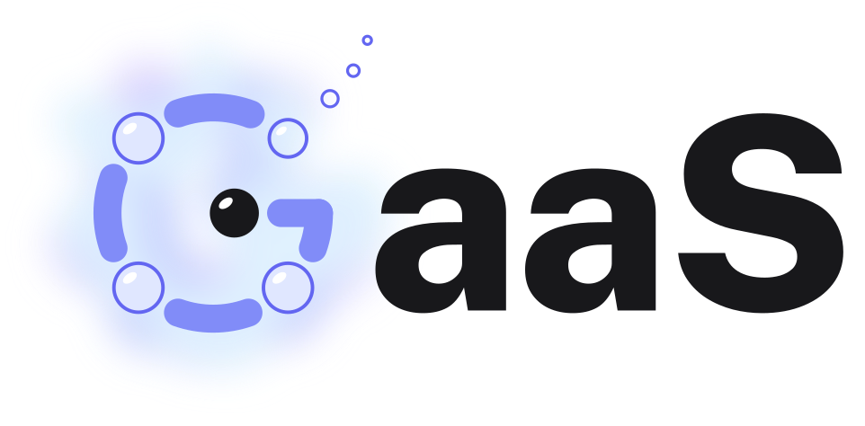

# GaaS Monorepo

  <picture>
    <source media="(prefers-color-scheme: dark)" srcset="docs/public/gaas-wordmark-dark.svg">
    
  </picture>

## Overview

This monorepo contains all projects and packages related to GAAS (Galaxy As a Service), which provides tooling and interfaces for the [Galaxy Project](https://github.com/galaxyproject).

The Galaxy Project is an open-source platform for:

- Data-intensive biomedical research
- Reproducible scientific workflows
- Web-based analysis and visualization tools
- REST API for programmatic interactions

## Repository Structure

The monorepo consists of three main packages:

### **blendtype**

- TypeScript client for Galaxy Project REST API
- Provides type-safe interactions with Galaxy servers
- Similar to BioBlend but with full TypeScript support
- Handles authentication and workflow invocations
- Built to be tree-shakeable and modular

### **nuxt-galaxy**

- Nuxt module that integrates with Galaxy Project
- Leverages blendtype for Galaxy API communication
- Simplifies Galaxy integration in Nuxt applications
- Features:
  - Authentication handling and data persistence with Supabase
  - Workflow execution management
  - Workflow monitoring

### **gaas-ui**

- Nuxt layer built on top of nuxt-galaxy
- Provides pre-built pages and layouts
- Ready-to-use components for Galaxy interactions
- UI components for:
  - Dataset browsers
  - Job monitoring dashboards
  - Tool interfaces
- A wiki built on @nuxt/content:
  - Markdown pages with full-text search and navigation
  - DOI citations, with a bibliography appended to each page
  - TypeScript schema validation for content consistency

## Resources

- [Galaxy Project Documentation](https://docs.galaxyproject.org)
- [Galaxy API Documentation](https://docs.galaxyproject.org/en/latest/api/api.html)
- [Galaxy Training Network](https://training.galaxyproject.org)
- [Galaxy Community Hub](https://galaxyproject.org)

## Contributing

Please see the contributing guidelines in each package for development setup and contribution workflows.

## License

GaaS is MIT licensed, copyright Institut Pasteur: see [LICENSE](./LICENSE). Each published package ships this same file. [ADR 0007](./docs/adr/0007-mit-copyright-institut-pasteur-checked-with-reuse.md) records why Institut Pasteur holds the copyright while Rémi Planel is named as author.
